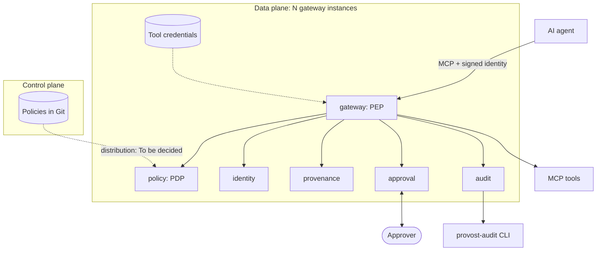
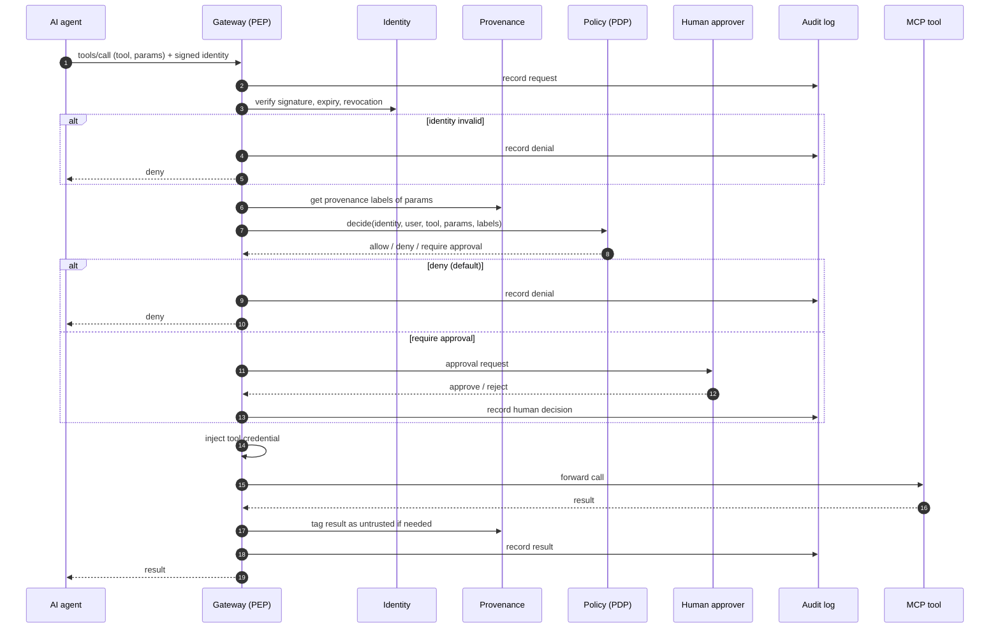
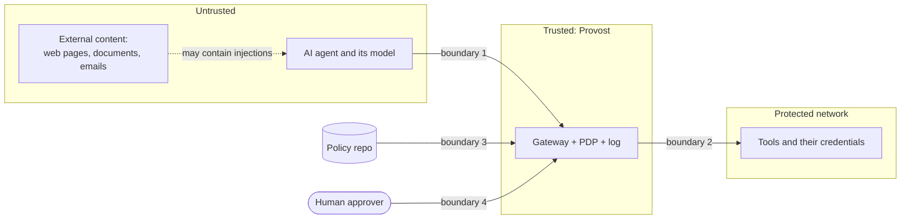

# Architecture

> Status: target design. Nothing described here is implemented yet. Items marked **To be decided** are open.

## Components

| Component | Package | Responsibility | Milestone |
|---|---|---|---|
| Gateway (PEP) | `internal/gateway` | MCP proxy. Intercepts every tool call, enforces the decision, injects tool credentials, forwards allowed calls. | 1 |
| Policy engine (PDP) | `internal/policy` | Evaluates deterministic rules on identity, tool and parameters. Default deny. | 2 |
| Identity | `internal/identity` | Issues and verifies short-lived signed agent identities bound to a user. Rotation and revocation. | 3 |
| Audit log | `internal/audit` | Appends requests, decisions and results to a hash-chained, signed log. | 1 (basic), 4 (tamper-evident) |
| Human approval | `internal/approval` | Holds irreversible or outbound actions until a human approves or rejects them. | 5 |
| Provenance | `internal/provenance` | Tags data from untrusted sources and prevents it from choosing the target of a sensitive action. | 5 |
| Gateway binary | `cmd/provost` | Entry point of the gateway. | 1 |
| Audit CLI | `cmd/provost-audit` | Verifies the integrity of an audit log. | 4 |

## Component diagram

## Life of a tool call

Notes:

- The agent never sees the tool credential. It is added by the gateway after the decision (step "inject tool credential").
- A refused call never reaches the tool.
- The behaviour when the audit log cannot be written is **To be decided** (fail-closed is the default leaning, see [ADR 0002](docs/adr/0002-default-deny.md)).

## Trust boundaries

| # | Boundary | What crosses it | Guarantee expected |
|---|---|---|---|
| 1 | Agent → gateway | MCP calls, signed identity | Every call authenticated and evaluated |
| 2 | Gateway → tools | Allowed calls with credentials | Only the gateway can reach tools (network isolation) |
| 3 | Policy repo → gateway | Policies | Policies are versioned and reviewed. Integrity of distribution: **To be decided** |
| 4 | Approver → gateway | Approval decisions | Approver authentication: **To be decided** |

The full analysis is in [docs/threat-model.md](docs/threat-model.md).

## Repository layout

| Folder | Role |
|---|---|
| `cmd/provost/` | Gateway binary (`main` only, wiring of `internal/` packages) |
| `cmd/provost-audit/` | Audit log verification CLI |
| `internal/gateway/` | MCP interception, enforcement, credential injection |
| `internal/policy/` | PDP: rule loading and evaluation |
| `internal/identity/` | Agent identity tokens: issuance, verification, rotation, revocation |
| `internal/audit/` | Hash-chained, signed append-only log |
| `internal/approval/` | Human-in-the-loop workflow |
| `internal/provenance/` | Data provenance labels and propagation |
| `policies/` | Policy files (control plane, versioned in Git) |
| `deploy/compose/` | Docker Compose demo on an isolated network |
| `examples/demo-agent/` | Demo agent used by the scenarios |
| `test/scenarios/` | End-to-end scenarios proving each milestone's acceptance criteria |
| `docs/adr/` | Architecture Decision Records |

Go's `internal/` directory prevents other modules from importing these packages. The public surface of Provost is its binaries and its policy format, not a Go library.

## Open choices

| Topic | Status |
|---|---|
| Policy language: Cedar or OPA/Rego | **To be decided** at milestone 2 ([ADR 0005](docs/adr/0005-policy-language-cedar-or-opa.md)) |
| MCP transports supported (stdio, Streamable HTTP) | **To be decided** at milestone 1 |
| Where tool credentials are stored (file, secret manager) | **To be decided** |
| Identity token format details (JWT claims, lifetime) | **To be decided** at milestone 3 |
| Revocation mechanism | **To be decided** at milestone 3 |
| Audit log storage backend and key management | **To be decided** at milestone 4 |
| Approval channel (CLI, web UI, chat) | **To be decided** at milestone 5 |
| How provenance labels are propagated through the agent | **To be decided** at milestone 5 |
| Policy distribution to instances (pull, push, signed bundles) | **To be decided** at milestone 6 |
| Behaviour when the log or the PDP is unavailable | **To be decided** (fail-closed leaning) |
