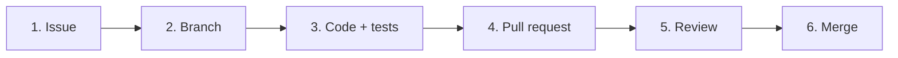

# Contributing to Provost

Thank you for your interest. Provost is an educational prototype. Contributions are welcome within the scope of [ROADMAP.md](ROADMAP.md).

## Workflow



1. **Issue.** Every change starts with an issue describing the problem, the milestone concerned and the expected behaviour. For a structural decision, propose an ADR draft.
2. **Branch.** Create a branch from `main`, named `<type>/<issue-number>-<short-description>`, for example `feat/12-sql-drop-rule`.
3. **Code and tests.** Each feature comes with its tests (allowed path and denied path). See [CLAUDE.md](CLAUDE.md) for Go and testing conventions, which apply to humans too.
4. **Pull request.** Reference the issue, explain what changed and why, and list how it was tested.
5. **Review.** At least one review is required. Changes to `policies/`, `internal/policy/`, `internal/identity/` or `internal/audit/` get extra scrutiny. Number of required reviewers: **To be decided**.
6. **Merge.** Merge strategy (squash or merge commit): **To be decided**.

## Commit conventions

Commits follow [Conventional Commits](https://www.conventionalcommits.org/):

```
<type>(<scope>): <summary in imperative mood, lowercase, no final period>

<optional body: what and why>

<optional footer: Refs #12, BREAKING CHANGE: ...>
```

**Types:** `feat`, `fix`, `docs`, `test`, `refactor`, `chore`, `ci`, `perf`, `security`.

**Scopes:** `gateway`, `policy`, `identity`, `audit`, `approval`, `provenance`, `cli`, `deploy`, `demo`, `docs`, `adr`.

Examples:

```
feat(policy): deny SQL statements containing DROP
fix(identity): reject tokens with a future issued-at claim
docs(adr): propose ADR 0006 on policy distribution
```

## Ground rules

- No real data or keys, anywhere.
- Never weaken a deny rule to make a test pass.
- Security issues are **not** reported through public issues: see [SECURITY.md](SECURITY.md).
