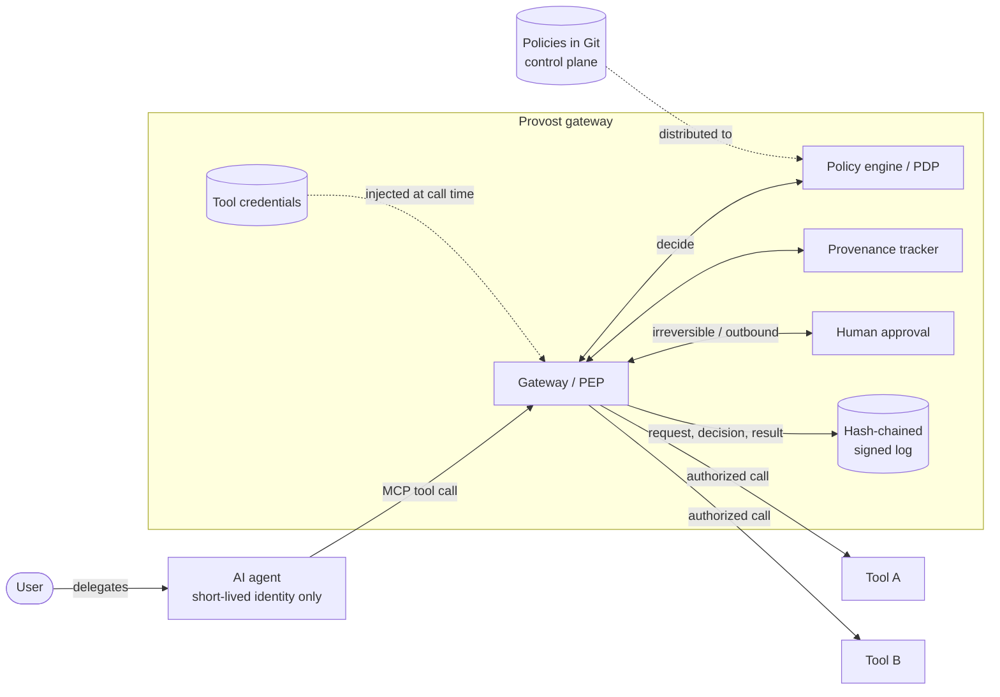

# Provost

> An open-source security gateway, written in Go, that checks every action of an AI agent **before** it is executed.

## The problem

AI agents increasingly call real tools (databases, APIs, file systems) through protocols such as MCP. In most setups today:

- the agent **holds the credentials** of the tools it uses;
- nothing deterministic stands between what the model *decides* and what the tool *executes*;
- a single prompt injection hidden in a web page or a document can turn the agent against its own user;
- there is no trustworthy record of who asked for what, what was allowed, and what happened.

Provost puts a policy-enforcing gateway between the agent and its tools.

## Principles

1. **The agent holds no rights and no secrets.** It only has a short-lived signed identity (Ed25519 / JWT, inspired by SPIFFE), bound to the user it acts for. It can never exceed that user's rights.
2. **Every tool call goes through the gateway.** The gateway (Policy Enforcement Point, PEP) intercepts each MCP tool call. It alone holds the tool credentials and injects them at call time.
3. **Default deny.** A decision engine (Policy Decision Point, PDP) evaluates deterministic rules on identity, tool and parameters. Anything not explicitly allowed is refused. Policy language: Cedar or OPA/Rego, **to be decided at milestone 2** ([ADR 0005](docs/adr/0005-policy-language-cedar-or-opa.md)).
4. **Humans approve what cannot be undone.** Irreversible or outbound actions require human approval.
5. **Everything is recorded, tamper-evidently.** Each request, decision and result is written to a hash-chained, signed log, verifiable with a dedicated CLI.
6. **Untrusted data cannot steer sensitive actions.** Data coming from untrusted sources is tagged with its provenance and cannot choose the target of a sensitive action, following the CaMeL model (Google DeepMind).
7. **Control plane and data plane are separate.** Policies are versioned in Git (control plane); several gateway instances decide locally (data plane).

## Project status

🚧 **Skeleton. Milestone 1 upcoming.** This repository currently contains documentation only. There is no code yet. See [ROADMAP.md](ROADMAP.md).

> ⚠️ Provost is an educational prototype. It is **not** intended for production use. See [SECURITY.md](SECURITY.md).

## Architecture at a glance

Details: [ARCHITECTURE.md](ARCHITECTURE.md).

## Quick start

**Coming soon** (milestone 1). The demo will run with Docker Compose on an isolated network where only the gateway can reach the tools. All data and keys in the demo are 100% fictitious.

## Documentation

| Document | Content |
|---|---|
| [ARCHITECTURE.md](ARCHITECTURE.md) | Components, tool-call flow, trust boundaries, open choices |
| [ROADMAP.md](ROADMAP.md) | The 6 milestones and their acceptance criteria |
| [docs/threat-model.md](docs/threat-model.md) | Actors, assets, threats and planned mitigations |
| [docs/adr/](docs/adr/) | Architecture Decision Records |
| [CONTRIBUTING.md](CONTRIBUTING.md) | Workflow and commit conventions |
| [SECURITY.md](SECURITY.md) | Reporting vulnerabilities |
| [CLAUDE.md](CLAUDE.md) | Instructions for AI coding agents working on this repository |

## License

[Apache License 2.0](LICENSE).
