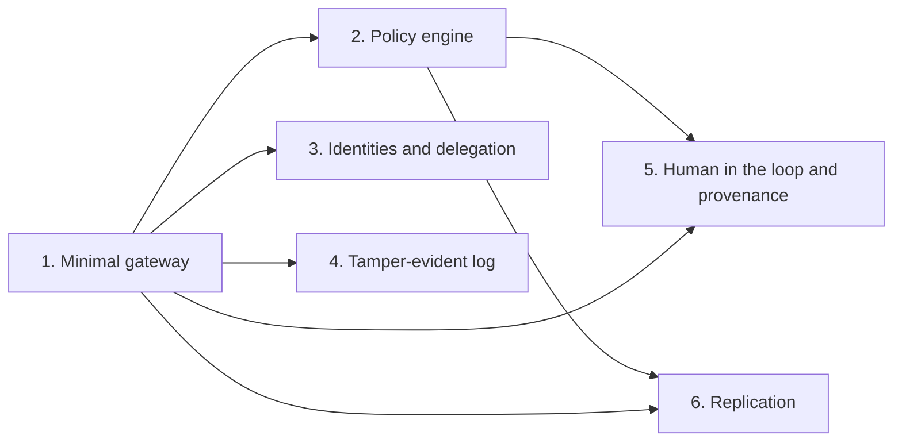

# Roadmap

Six milestones. Each one has a single deliverable and ends when its acceptance criteria are demonstrated by a scenario in `test/scenarios/`. No dates are committed.

## Milestone 1: Minimal gateway

**Deliverable:** an MCP proxy that intercepts tool calls, denies by default and logs.

**Depends on:** nothing.

**Acceptance criteria:**

- [ ] Every MCP tool call from the demo agent goes through the gateway.
- [ ] A call with no matching allow rule is denied.
- [ ] Each request and decision is written to a log.
- [ ] In the Docker Compose demo, the agent cannot reach a tool except through the gateway.

## Milestone 2: Policy engine

**Deliverable:** rules evaluated on identity, tool and parameters.

**Depends on:** milestone 1.

**Acceptance criteria:**

- [ ] The policy language is chosen and recorded (ADR 0005 accepted).
- [ ] An SQL query containing `DROP` is denied.
- [ ] An authorized read query is allowed.

## Milestone 3: Identities and delegation

**Deliverable:** short-lived signed agent identities, with rotation and revocation.

**Depends on:** milestone 1.

**Acceptance criteria:**

- [ ] An expired token is rejected.
- [ ] A forged or tampered token is rejected.
- [ ] A revoked token is rejected.
- [ ] The agent never exceeds the rights of the user it acts for.

## Milestone 4: Tamper-evident log

**Deliverable:** hash-chained, signed log and the `provost-audit` verification CLI.

**Depends on:** milestone 1.

**Acceptance criteria:**

- [ ] Each entry is chained to the previous one by its hash.
- [ ] Log entries are signed.
- [ ] `provost-audit` detects the modification of a single line.

## Milestone 5: Human in the loop and provenance

**Deliverable:** human approval for irreversible or outbound actions, and provenance tags on untrusted data.

**Depends on:** milestones 1 and 2.

**Acceptance criteria:**

- [ ] An irreversible or outbound action is held until a human approves it.
- [ ] Data from an untrusted source cannot choose the target of a sensitive action.
- [ ] The prompt-injection exfiltration demo is blocked.

## Milestone 6: Replication

**Deliverable:** several gateway instances, policy distribution, load tests.

**Depends on:** milestones 1 and 2.

**Acceptance criteria:**

- [ ] Several instances apply the same policies.
- [ ] Policies are distributed from the Git control plane to all instances.
- [ ] The latency added by the gateway is measured and published (no target set in advance: **To be decided**).
