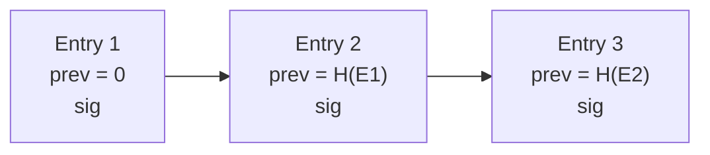

# ADR 0004: Hash-chained, signed audit log

- **Status:** Accepted
- **Date:** 2026-11-25
- **Milestone:** 4

## Context

After an incident, we must know which agent, acting for which user, requested what, what was decided and what happened. A plain log file can be edited silently by anyone with write access, including an attacker covering their tracks.

## Decision

- Each request, decision and result is appended as one entry.
- Each entry contains the hash (SHA-256) of the previous entry, forming a chain.
- Entries are signed (Ed25519) by the gateway.
- A dedicated CLI, `provost-audit`, verifies the chain and the signatures and reports the first broken entry.

## Consequences

- **Positive:**
  - Modifying, inserting or reordering an entry breaks the chain and is detected.
  - Signatures prove the entries were written by a gateway holding the key.
  - Verification is offline and independent of the gateway.
- **Negative:**
  - Tamper-**evident**, not tamper-**proof**: an attacker can still delete the log, or truncate its end. Detecting truncation needs extra measures (periodic anchoring of the latest hash elsewhere), **To be decided**.
  - Signing every entry has a cost, to be measured at milestone 6. Batch signing is an option, **To be decided**.
  - The signing key becomes a sensitive asset. Key storage, **To be decided**.
  - Logs may contain sensitive parameters. Redaction policy, **To be decided**.
- **Follow-up:** storage backend, entry format, key management.

## Alternatives considered

| Option | Why not chosen |
|---|---|
| Plain log file | Silent modification is possible |
| Hash chain without signatures | Anyone can recompute a valid chain after editing |
| Merkle tree / transparency log (e.g. Trillian) | Stronger, enables efficient inclusion proofs, but more complex than needed at this stage. Possible later evolution. |
| External append-only storage only (WORM) | Depends on a specific infrastructure. Can complement the hash chain. |
